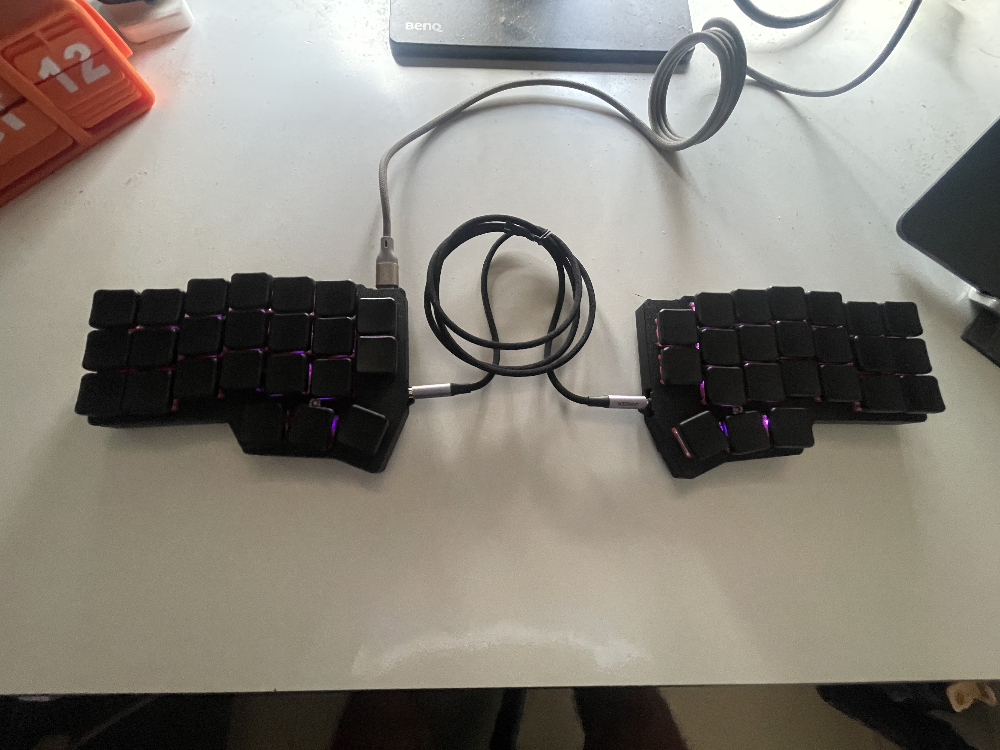

# Corne RP2040 keyboard

A wired Corne Chocolate v4.1 split keyboard made with [tscircuit](https://tscircuit.com/imrishabh18/corne-keyboard), based on [foostan/crkbd](https://github.com/foostan/crkbd). Each half has 21 Choc V1 hot-swap positions, an RP2040, USB-C and a TRRS connector. The printable cases are black with white illustrative keycaps and a flat switch plate.



## Files

| File | Purpose |
| --- | --- |
| `panel.circuit.json` | Saved fabricated PCB-only panel with rails and mousebites. This is the package preview and cloud build entrypoint; it contains no enclosure assembly. |
| `index.circuit.tsx` | Editable two-board panel source. |
| `left.circuit.tsx`, `right.circuit.tsx` | PCB and enclosure assemblies. The `*-enclosure.circuit.tsx` files provide aliases. |
| `left-printed-parts.circuit.tsx`, `right-printed-parts.circuit.tsx` | Separate `assembly.printedpart` definitions for each base and switch plate. |
| `assembly/*-pcb-mounted.json` | JSCAD plans for cases, plates and illustrative hardware. |
| `lib/`, `imports/` | Referenced PCB layouts, reviewed routes, panel features and imported component footprints. |

The JSON files referenced by the source are required. The combined panel/enclosure snapshot, older enclosure revisions, experiment outputs and generated STEP files are omitted.

## Preview and export

Install Bun and the [tscircuit CLI](https://github.com/tscircuit/cli), then run:

```sh
bun install
tsci dev
```

Open `panel.circuit.json` for the PCB-only panel. Open `left.circuit.tsx` or `right.circuit.tsx` for the respective PCB and enclosure assembly. Run `bun run build` to generate the saved panel preview and both printed-parts export files.

With a website version supporting file-specific downloads, open `left-printed-parts.circuit.tsx` or `right-printed-parts.circuit.tsx` in **Files**, then choose **Download → Assembly STEP (ZIP)**. With the CLI, run:

```sh
tsci export left-printed-parts.circuit.tsx --format assembly-step
tsci export right-printed-parts.circuit.tsx --format assembly-step
```

Each half exports a ZIP containing its own case base and switch plate: `left_CASE_BASE.step` and `left_SWITCH_PLATE.step`, or `right_CASE_BASE.step` and `right_SWITCH_PLATE.step`. Print the four parts separately at 100% scale in millimetres; place them flat on the slicer's bed. Electronics, switches and keycaps are illustrative and excluded from the printable STEP export. The panel view has no printable enclosure parts; select a left/right assembly or printed-parts circuit to export them.

## Enclosure assembly

The current case uses four **M3 × 10 mm DIN 7991 countersunk screws per half**, with heads no larger than 6 mm diameter and 1.7 mm height. Socket-cap screws require a different head recess. Screws enter from the plate, pass through 3.4 mm plate clearance holes and the existing 5 mm PCB mounting openings, then engage 2.8 mm blind pilots in the PLA base. Check printed hole fit before installing the PCB; do not force a screw into a tight bore.

The rim is 1.2 mm thick. Interior supports and plate ribs support the middle keys. The plate stays flat above USB-C and TRRS, with edge notches for cables.

## Cloud build and fabrication

Cloud builds use the bundled tscircuit runtime and build the saved PCB panel plus the two printed-parts circuits. Each printed-parts circuit contains only its base and plate; the panel contains no enclosure assembly. Large JavaScript library bundles are unnecessary for this package.

The saved PCB geometry and routing are preserved. The editable TSX source currently has framework placement/panel diagnostics and must be reviewed before generating replacement fabrication files. This package cleanup does not constitute a new fabrication sign-off.
